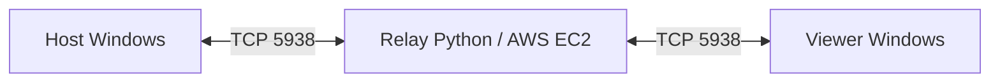

# Conect — acesso remoto com relay na AWS

Projeto acadêmico em Python para visualizar e controlar um computador Windows a distância, com um servidor intermediário que pode ser hospedado no Amazon EC2.

Desenvolvi o Conect no semestre passado para me desafiar a construir uma solução de acesso remoto e configurar sua infraestrutura na AWS. A ideia nasceu pensando em empresas de suporte: simplificar o atendimento e explorar uma alternativa com menor custo de licenciamento. Essa é a motivação do projeto, não uma economia comprovada ou uma oferta comercial já disponível.

> **Status:** protótipo acadêmico para estudo e demonstrações em ambiente controlado. O código pode ser executado seguindo as instruções abaixo, mas esta publicação não comprova que a antiga instância EC2 continua ativa. A versão atual não deve ser exposta diretamente à internet para uso empresarial: não implementa TLS e usa senha numérica de quatro dígitos.

## O que está implementado

- Interface desktop com PySide6 para Host e Viewer.
- Identificação do Host com ID de nove dígitos e senha de quatro dígitos.
- Captura com MSS e transmissão de quadros JPEG com OpenCV e NumPy.
- Controle de mouse, cliques, rolagem e teclado com PyAutoGUI.
- Seleção de monitor e ajustes para escala de tela no Windows.
- Relay TCP com sockets e threads, na porta 5938.
- Qualidade JPEG, limite de FPS e monitor inicial configuráveis.

## Arquitetura e fluxo



1. O Host abre uma conexão de saída e registra seu ID e senha no relay.
2. O Viewer abre outra conexão e informa as credenciais compartilhadas pelo usuário do Host.
3. O relay verifica as credenciais e encaminha bytes nos dois sentidos.
4. O Host envia imagens JPEG e informações do monitor; o Viewer envia comandos de mouse e teclado.

O protocolo usa uma mensagem JSON terminada por quebra de linha no registro e na autenticação. Durante a sessão, cada pacote tem um byte de tipo, quatro bytes de tamanho em ordem de rede e o conteúdo. O relay transporta a sessão; não há conexão direta entre Host e Viewer.

## Estrutura

```text
aws_relay/   servidor TCP e protocolo
host_app/    captura de tela e execução dos comandos
viewer_app/  visualização e envio dos comandos
docs/        implantação, segurança e validação
host.spec    empacotamento do Host com PyInstaller
viewer.spec  empacotamento do Viewer com PyInstaller
```

Os arquivos de compilação e executáveis do ZIP original foram excluídos da publicação. Os fontes e os arquivos de empacotamento foram mantidos. O endereço antigo da EC2 foi substituído por localhost; configure seu próprio relay.

## Executar localmente

Requisito de referência: Python 3.10, identificado nos artefatos originais. Host e Viewer são voltados ao Windows com sessão gráfica. O relay usa apenas a biblioteca padrão do Python. As dependências ainda não possuem versões fixadas.

Na raiz do repositório, em PowerShell:

```powershell
python -m venv .venv
.\.venv\Scripts\python.exe -m pip install -r host_app/requirements.txt
```

Abra três terminais na raiz. No primeiro, inicie o relay:

```powershell
.\.venv\Scripts\python.exe aws_relay/server.py
```

No segundo, inicie o Host:

```powershell
$env:CONECT_RELAY_HOST = "127.0.0.1"
.\.venv\Scripts\python.exe host_app/host.py
```

No terceiro, inicie o Viewer:

```powershell
$env:CONECT_RELAY_HOST = "127.0.0.1"
.\.venv\Scripts\python.exe viewer_app/viewer.py
```

Ative o compartilhamento no Host e informe seu ID e senha no Viewer. Para testar controle remoto, prefira duas máquinas ou uma máquina virtual: controlar a própria tela que está sendo exibida pode gerar recursão visual. Use somente equipamentos autorizados.

## Configurações

Defina as variáveis no terminal antes de iniciar o aplicativo. Os scripts não carregam arquivos `.env` automaticamente.

| Variável | Padrão | Uso |
| --- | --- | --- |
| `CONECT_RELAY_HOST` | `127.0.0.1` | Endereço do relay no Host e no Viewer |
| `CONECT_JPEG_QUALITY` | `72` | Qualidade JPEG do Host, de 0 a 100 |
| `CONECT_FPS` | `30` | Limite pretendido de captura; desempenho real varia |
| `CONECT_MONITOR_INDEX` | `1` | Monitor inicial do Host, a partir de 1 |

A porta é definida pela lista `PORTS` em cada `config.py`; mantenha os três componentes alinhados.

## AWS e executáveis

Veja [implantação na AWS](docs/AWS.md). Para gerar os executáveis no Windows, a partir da raiz e com as dependências instaladas:

```powershell
.\.venv\Scripts\python.exe -m pip install pyinstaller
.\.venv\Scripts\python.exe -m PyInstaller host.spec
.\.venv\Scripts\python.exe -m PyInstaller viewer.spec
```

As saídas ficam em `dist/host` e `dist/viewer`. Este procedimento de empacotamento ainda precisa ser validado nesta publicação.

## Limitações e próximos passos

Leia [segurança e validação](docs/SECURITY.md). Prioridades: TLS com validação de certificado, autenticação mais forte, proteção contra tentativas repetidas, consentimento por sessão, limites de pacotes, correção do registro do Host após senha incorreta e testes entre máquinas.

Não há aqui comprovação de latência, disponibilidade, economia ou desempenho equivalente a produtos comerciais. A hospedagem tem custos de computação e tráfego. Nenhuma licença de software foi acrescentada: publicar o código não define uma licença comercial barata nem autoriza automaticamente redistribuição.

## Autor

[euquadrado](https://github.com/euquadrado) — projeto de portfólio para demonstrar aprendizado em Python, redes, interfaces desktop e infraestrutura na AWS.
